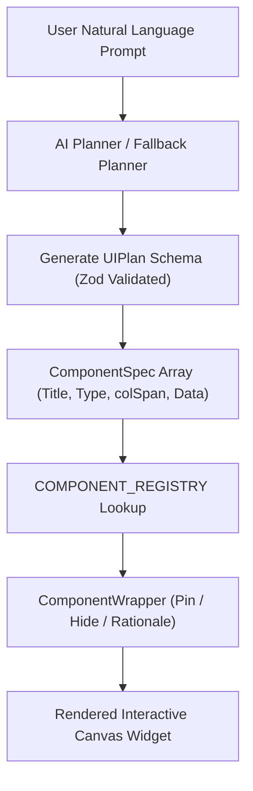

# 🧩 SaarthAI — Component Architecture & Reference Guide

This document provides a detailed breakdown of all user-interface components available in **SaarthAI Adaptive Workspace**, explaining their responsibilities, features, data sources, and role in the adaptive workspace pipeline.

---

## 🏗️ 1. Core & Layout Components (`src/components/common/`)

These persistent components structure the application layout, handle user navigation, enforce security boundaries, and orchestrate workspace transitions.

| Component | File | Description & Functionality |
| :--- | :--- | :--- |
| **`Header`** | [`Header.tsx`](file:///c:/Users/NIKUNJ/OneDrive/Desktop/hackwave3/LedgerLords-D/client/src/components/common/Header.tsx) | The sticky top application bar. Features the **SaarthAI official branding logo**, a floating pill navigation bar (**Home**, **Notifications**, **Preferences**, **Profile**), notification alert indicators, AI engine status badges, and light/dark theme controls. |
| **`Sidebar`** | [`Sidebar.tsx`](file:///c:/Users/NIKUNJ/OneDrive/Desktop/hackwave3/LedgerLords-D/client/src/components/common/Sidebar.tsx) | The persistent side navigation bar. Displays the active workspace intent tag, a collapsible **Relevant Sections** tree with one-click smooth scrolling to any component on the canvas, and a **Previous Results** history feed that lets users restore prior workspace states. |
| **`CommandBar`** | [`CommandBar.tsx`](file:///c:/Users/NIKUNJ/OneDrive/Desktop/hackwave3/LedgerLords-D/client/src/components/common/CommandBar.tsx) | The primary natural-language goal input surface. Accepts user intent prompts, renders loading spin states during adaptation, and presents quick starter prompts (e.g., *"Prepare for a client meeting"*, *"Investigate a product usage drop"*). |
| **`ComponentWrapper`** | [`ComponentWrapper.tsx`](file:///c:/Users/NIKUNJ/OneDrive/Desktop/hackwave3/LedgerLords-D/client/src/components/common/ComponentWrapper.tsx) | Universal security and lifecycle container that wraps every dynamically generated widget. Manages responsive grid column spanning (`col-span-1` through `col-span-4`), displays component titles, provides an **AI Rationale Tooltip** (*"Why is this here?"*), and provides **Pin** and **Hide** actions. |
| **`ClarificationModal`** | [`ClarificationModal.tsx`](file:///c:/Users/NIKUNJ/OneDrive/Desktop/hackwave3/LedgerLords-D/client/src/components/common/ClarificationModal.tsx) | Interactive disambiguation dialog triggered when a user query matches multiple entities (e.g., distinguishing between *Acme Corp* vs *Acme Labs*), presenting key attributes and allowing users to confirm the exact target. |
| **`NotificationToast`** | [`NotificationToast.tsx`](file:///c:/Users/NIKUNJ/OneDrive/Desktop/hackwave3/LedgerLords-D/client/src/components/common/NotificationToast.tsx) | Floating alert toast for system feedback, mock action confirmations, error warnings, and workspace adaptation notifications. |

---

## 📊 2. General & System Primitives (`src/components/general/`)

Foundational widgets for high-level summaries, timelines, actionable recommendations, and explainability.

| Component | File | Description & Functionality |
| :--- | :--- | :--- |
| **`MetricCard`** | [`MetricCard.tsx`](file:///c:/Users/NIKUNJ/OneDrive/Desktop/hackwave3/LedgerLords-D/client/src/components/general/MetricCard.tsx) | Key performance indicator (KPI) display. Shows headline metrics, percentage change vs previous period (positive/negative badges), progress meters, and contextual subtext. |
| **`ActivityTimeline`** | [`ActivityTimeline.tsx`](file:///c:/Users/NIKUNJ/OneDrive/Desktop/hackwave3/LedgerLords-D/client/src/components/general/ActivityTimeline.tsx) | Chronological stream of system, team, and account events with categorization badges (deployments, customer communications, milestone completions). |
| **`RecommendationCard`** | [`RecommendationCard.tsx`](file:///c:/Users/NIKUNJ/OneDrive/Desktop/hackwave3/LedgerLords-D/client/src/components/general/RecommendationCard.tsx) | AI-generated proactive recommendation cards with severity badges, rationale explanations, and 1-click execution action buttons. |
| **`WorkspaceExplanationPanel`** | [`WorkspaceExplanationPanel.tsx`](file:///c:/Users/NIKUNJ/OneDrive/Desktop/hackwave3/LedgerLords-D/client/src/components/general/WorkspaceExplanationPanel.tsx) | Expandable transparent inspection drawer revealing the detected user intent, extracted entities, connected data sources, and why specific components were selected. |
| **`WorkspaceChangeSummary`** | [`WorkspaceChangeSummary.tsx`](file:///c:/Users/NIKUNJ/OneDrive/Desktop/hackwave3/LedgerLords-D/client/src/components/general/WorkspaceChangeSummary.tsx) | Diffing banner summarizing workspace adaptations (added, updated, retained, and de-prioritized components). Can be suppressed or displayed as needed. |

---

## 👥 3. Client & Communication Domain (`src/components/clients/`)

Components tailored for customer success managers, account executives, and relationship tracking.

| Component | File | Description & Functionality |
| :--- | :--- | :--- |
| **`ClientProfileCard`** | [`ClientProfileCard.tsx`](file:///c:/Users/NIKUNJ/OneDrive/Desktop/hackwave3/LedgerLords-D/client/src/components/clients/ClientProfileCard.tsx) | Comprehensive account overview. Displays account name, ARR, health status (Healthy, At Risk, Escalated), primary contacts, active contract tier, and key industry metadata. |
| **`CommunicationTimeline`** | [`CommunicationTimeline.tsx`](file:///c:/Users/NIKUNJ/OneDrive/Desktop/hackwave3/LedgerLords-D/client/src/components/clients/CommunicationTimeline.tsx) | Inbound/outbound communication log (emails, calls, meeting summaries). Features automated sentiment analysis tags (Positive, Neutral, Urgent) and participant tags. |
| **`OpenIssuesList`** | [`OpenIssuesList.tsx`](file:///c:/Users/NIKUNJ/OneDrive/Desktop/hackwave3/LedgerLords-D/client/src/components/clients/OpenIssuesList.tsx) | Active support and operational tickets. Highlights severity badges (P0, P1, P2), SLA deadlines, assignees, and quick link actions to resolve or escalate. |
| **`MeetingAgendaPanel`** | [`MeetingAgendaPanel.tsx`](file:///c:/Users/NIKUNJ/OneDrive/Desktop/hackwave3/LedgerLords-D/client/src/components/clients/MeetingAgendaPanel.tsx) | Structured agenda outline for upcoming client meetings, detailing time blocks, talking points, presenter assignments, and expected outcomes. |
| **`MeetingNotesPanel`** | [`MeetingNotesPanel.tsx`](file:///c:/Users/NIKUNJ/OneDrive/Desktop/hackwave3/LedgerLords-D/client/src/components/clients/MeetingNotesPanel.tsx) | Collaborative meeting minutes editor. Captures discussion transcripts, key decisions made, and follow-up action items with assignees. |

---

## 📈 4. Product Analytics & Diagnostics (`src/components/analytics/`)

Data visualization and root-cause analysis tools for product managers, engineering leads, and data analysts.

| Component | File | Description & Functionality |
| :--- | :--- | :--- |
| **`UsageTrendChart`** | [`UsageTrendChart.tsx`](file:///c:/Users/NIKUNJ/OneDrive/Desktop/hackwave3/LedgerLords-D/client/src/components/analytics/UsageTrendChart.tsx) | Interactive multi-line/area chart (powered by Recharts). Shows 90 days of Daily Active Users (DAU), session durations, and correlates anomalies with product release milestones. |
| **`FeatureAdoptionChart`** | [`FeatureAdoptionChart.tsx`](file:///c:/Users/NIKUNJ/OneDrive/Desktop/hackwave3/LedgerLords-D/client/src/components/analytics/FeatureAdoptionChart.tsx) | Comparative bar chart illustrating feature adoption velocity, usage frequency, and identifying underperforming or declining modules. |
| **`ReleaseTimeline`** | [`ReleaseTimeline.tsx`](file:///c:/Users/NIKUNJ/OneDrive/Desktop/hackwave3/LedgerLords-D/client/src/components/analytics/ReleaseTimeline.tsx) | Version release roadmap and history track. Shows deployed build versions (e.g. v2.8.4), release dates, authors, and associated changelog summaries. |
| **`SupportIncidentList`** | [`SupportIncidentList.tsx`](file:///c:/Users/NIKUNJ/OneDrive/Desktop/hackwave3/LedgerLords-D/client/src/components/analytics/SupportIncidentList.tsx) | Real-time incident tracker. Details error classifications (timeout, memory, 504), affected endpoints, blast radius, and current resolution progress. |
| **`EvidenceBasedInsightList`** | [`EvidenceBasedInsightList.tsx`](file:///c:/Users/NIKUNJ/OneDrive/Desktop/hackwave3/LedgerLords-D/client/src/components/analytics/EvidenceBasedInsightList.tsx) | AI diagnostic cards detailing empirical hypotheses, confidence ratings, supporting telemetry evidence, and step-by-step remediation suggestions. |

---

## 🚀 5. Projects & Operational Tasks (`src/components/projects/`)

Execution tracking components for delivery leads, sprint managers, and cross-functional teams.

| Component | File | Description & Functionality |
| :--- | :--- | :--- |
| **`ProjectProgressCard`** | [`ProjectProgressCard.tsx`](file:///c:/Users/NIKUNJ/OneDrive/Desktop/hackwave3/LedgerLords-D/client/src/components/projects/ProjectProgressCard.tsx) | High-level initiative tracker. Shows percent completion bars, current milestone status, delivery target dates, and health indicators. |
| **`OverdueTasksTable`** | [`OverdueTasksTable.tsx`](file:///c:/Users/NIKUNJ/OneDrive/Desktop/hackwave3/LedgerLords-D/client/src/components/projects/OverdueTasksTable.tsx) | Interactive tabular grid of delayed and high-priority action items. Includes inline status editing, priority filtering, assignee avatars, and 1-click completion. |
| **`PriorityDistributionChart`** | [`PriorityDistributionChart.tsx`](file:///c:/Users/NIKUNJ/OneDrive/Desktop/hackwave3/LedgerLords-D/client/src/components/projects/PriorityDistributionChart.tsx) | Visual breakdown of workload distributed across Critical, High, Medium, and Low priorities to evaluate team focus and risk. |
| **`TeamWorkloadPanel`** | [`TeamWorkloadPanel.tsx`](file:///c:/Users/NIKUNJ/OneDrive/Desktop/hackwave3/LedgerLords-D/client/src/components/projects/TeamWorkloadPanel.tsx) | Resource utilization grid. Visualizes active story points and open tasks per team member, highlighting bottlenecks or over-allocated individuals. |
| **`DependencyIndicator`** | [`DependencyIndicator.tsx`](file:///c:/Users/NIKUNJ/OneDrive/Desktop/hackwave3/LedgerLords-D/client/src/components/projects/DependencyIndicator.tsx) | Deliverable blocker map showing critical path items that are blocking or blocked by other departments. |

---

## 📅 6. Scheduling & Meetings (`src/components/scheduling/`)

Coordination surfaces for assembling participants, finding mutual availability, and finalizing agendas.

| Component | File | Description & Functionality |
| :--- | :--- | :--- |
| **`MeetingScheduler`** | [`MeetingScheduler.tsx`](file:///c:/Users/NIKUNJ/OneDrive/Desktop/hackwave3/LedgerLords-D/client/src/components/scheduling/MeetingScheduler.tsx) | Complete booking module. Configures meeting title, duration presets (15m, 30m, 45m, 60m), platform selection (Google Meet, Zoom), and booking confirmation. |
| **`AvailabilityPanel`** | [`AvailabilityPanel.tsx`](file:///c:/Users/NIKUNJ/OneDrive/Desktop/hackwave3/LedgerLords-D/client/src/components/scheduling/AvailabilityPanel.tsx) | Multi-attendee calendar availability matrix. Highlights mutual free slots, busy blocks, and optimal meeting windows across time zones. |
| **`AttendeeSelector`** | [`AttendeeSelector.tsx`](file:///c:/Users/NIKUNJ/OneDrive/Desktop/hackwave3/LedgerLords-D/client/src/components/scheduling/AttendeeSelector.tsx) | Participant invitation control with autocomplete search, required/optional participant tagging, and email resolution. |
| **`AgendaEditor`** | [`AgendaEditor.tsx`](file:///c:/Users/NIKUNJ/OneDrive/Desktop/hackwave3/LedgerLords-D/client/src/components/scheduling/AgendaEditor.tsx) | Live checklist authoring tool for adding, reordering, and assigning talking points to attendees before dispatching invites. |

---

## 🔐 7. Authentication & Registry Architecture

| Component / File | Location | Role in Pipeline |
| :--- | :--- | :--- |
| **`AuthScreen`** | [`src/components/auth/AuthScreen.tsx`](file:///c:/Users/NIKUNJ/OneDrive/Desktop/hackwave3/LedgerLords-D/client/src/components/auth/AuthScreen.tsx) | User authentication gateway supporting session checking, sign-in, guest access, and displaying server health diagnostics when offline. |
| **`COMPONENT_REGISTRY`** | [`src/components/registry.tsx`](file:///c:/Users/NIKUNJ/OneDrive/Desktop/hackwave3/LedgerLords-D/client/src/components/registry.tsx) | The **Zero-Arbitrary-Code execution boundary**. Maps string identifiers generated by the AI planner (`ComponentType`) strictly to validated React components. Ensures that the LLM or planner can never execute arbitrary HTML or untrusted scripts. |

---

## 🔄 Dynamic Lifecycle: How Components Are Selected & Rendered

1. **User Goal Input**: Entered via [`CommandBar.tsx`](file:///c:/Users/NIKUNJ/OneDrive/Desktop/hackwave3/LedgerLords-D/client/src/components/common/CommandBar.tsx).
2. **Intent Parsing**: The planner extracts entities, determines the intent archetype, and produces a structured `UIPlan`.
3. **Registry Resolution**: [`registry.tsx`](file:///c:/Users/NIKUNJ/OneDrive/Desktop/hackwave3/LedgerLords-D/client/src/components/registry.tsx) matches each spec to its approved React component.
4. **Shell Ingestion**: Each component is wrapped in [`ComponentWrapper.tsx`](file:///c:/Users/NIKUNJ/OneDrive/Desktop/hackwave3/LedgerLords-D/client/src/components/common/ComponentWrapper.tsx) for layout control and explanation tooltips.
5. **Interactive Actions**: Components dispatch mock API calls or follow-up prompts to continually adapt the canvas.
